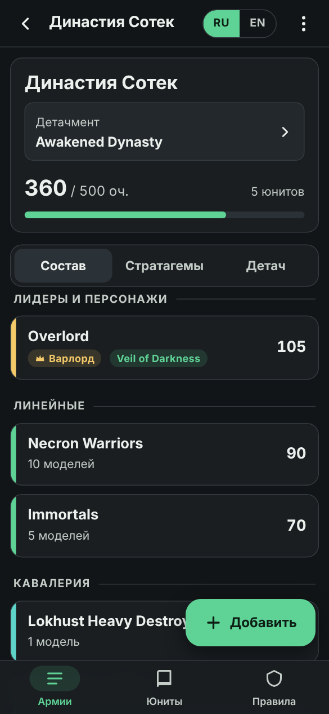
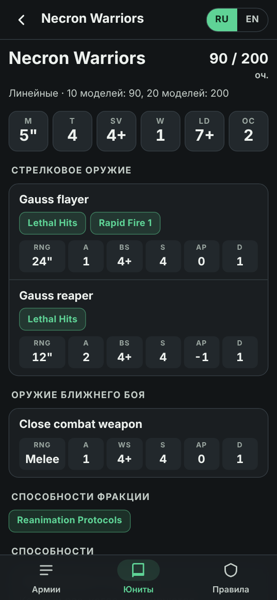
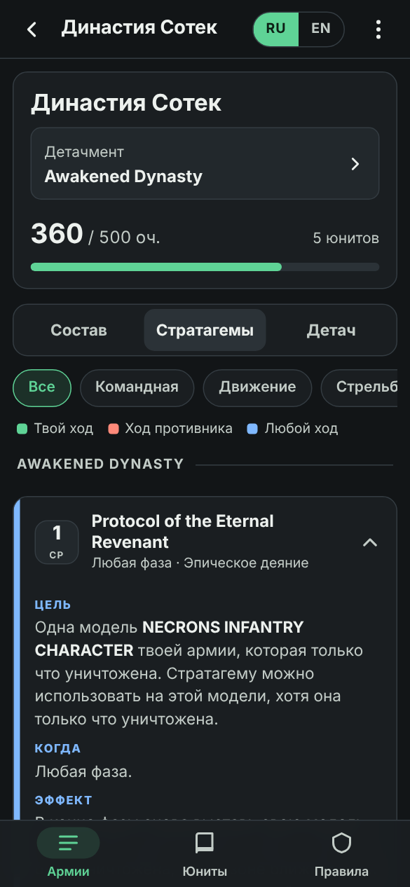
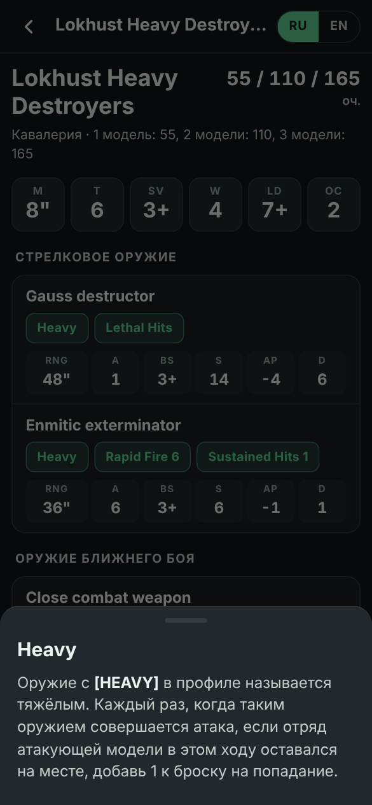

# 10k.app

**Карманный справочник для Warhammer 40,000 (10-я редакция).** Собираешь свою армию, и все её датащиты, стратагемы и правила детача открываются в один тап. Без регистрации, без рекламы, работает без интернета.

Пока есть только **Некроны**.

  
  
  
  

## Что умеет

- **Твои армии.** Задай лимит очков, выбери детач, добавь юниты. Очки считаются сами, можно указать размер отряда, энхансменты и варлорда.
- **Подсказывает ошибки.** Перебор очков, больше трёх одинаковых юнитов, два одинаковых энхансмента или нет варлорда — приложение покажет это сверху.
- **Датащиты.** Крупные характеристики, оружие, способности, к кому может присоединиться лидер.
- **Нажми на непонятное слово.** Lethal Hits, Deep Strike, Feel No Pain — тапни по подсвеченному слову, и снизу появится расшифровка.
- **Русский и английский.** Кнопка RU / EN в шапке переключает все правила сразу. Удобно, когда надо свериться с оригиналом или показать сопернику.
- **Стратагемы.** Стратагемы твоего детача и общие (Core), с фильтром по фазе хода. Цветом видно, в чей ход их можно играть.
- **Работает офлайн.** После первого открытия интернет не нужен, даже в клубе без связи.
- **Делиться армией.** Список можно скопировать текстом (например, отправить напарнику) или сохранить резервную копию и перенести на другой телефон.

## Как установить на телефон

1. Открой ссылку на приложение в **Chrome** на Android.
2. Нажми меню **⋮** → **Добавить на главный экран** (или «Установить приложение»).
3. На рабочем столе появится иконка, приложение открывается как обычное.

На iPhone то же самое делается в Safari: кнопка «Поделиться» → «На экран „Домой“».

## Важно знать

- **Армии хранятся только в этом телефоне.** Если очистить данные браузера, они пропадут. Время от времени сохраняй резервную копию: шестерёнка на главном экране → «Резервная копия».
- **Данные о юнитах, детачах и стратагемах** взяты с [10.40k.app](https://10.40k.app). Общие стратагемы (Core) и часть расшифровок ключевых слов записаны по базовым правилам, на турнире лучше свериться с официальными источниками.
- **Перевод любительский.** Названия юнитов, оружия и ключевых слов оставлены на английском, как их обычно называют за столом.
- Приложение неофициальное и не связано с Games Workshop. Тексты правил принадлежат Games Workshop.

## Нашёл ошибку или хочешь помочь?

Напиши в [Issues](../../issues): неправильные очки, кривой перевод, неудобная кнопка — всё пригодится. Как устроен проект и как обновлять данные, описано в [CONTRIBUTING.md](CONTRIBUTING.md).
